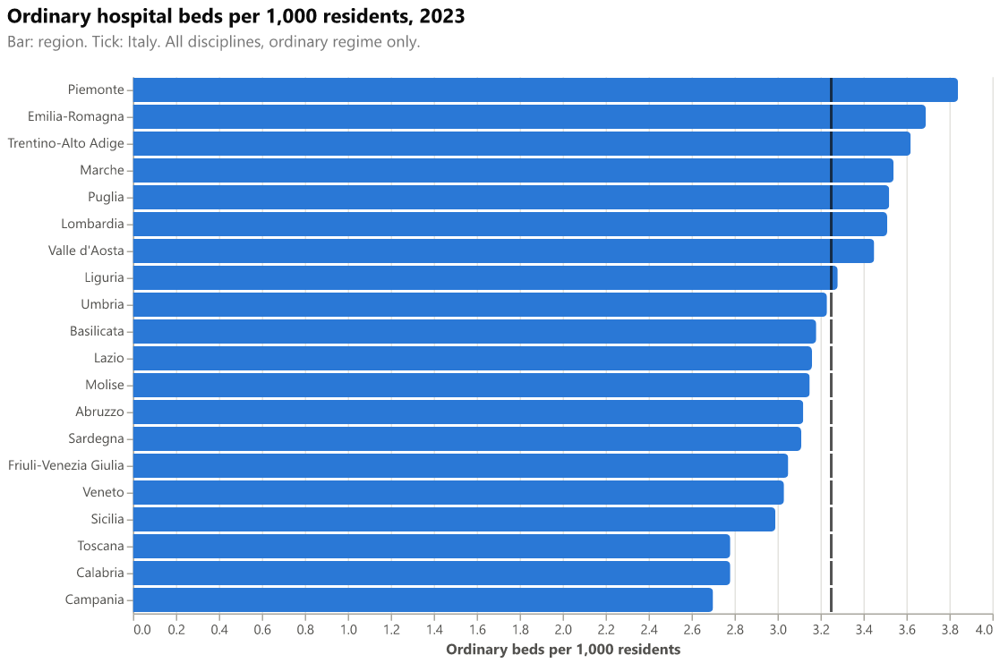
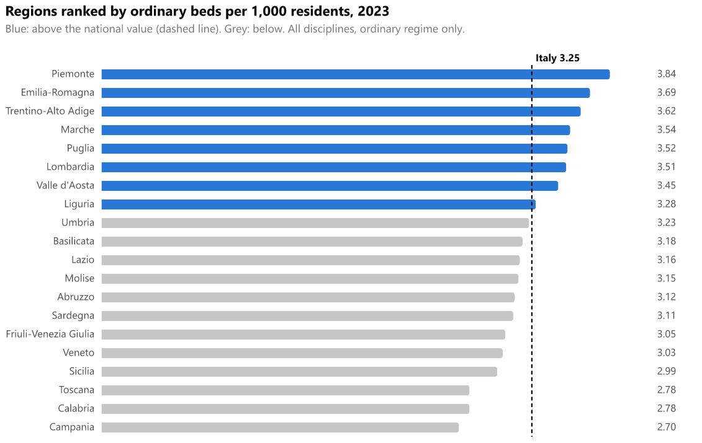
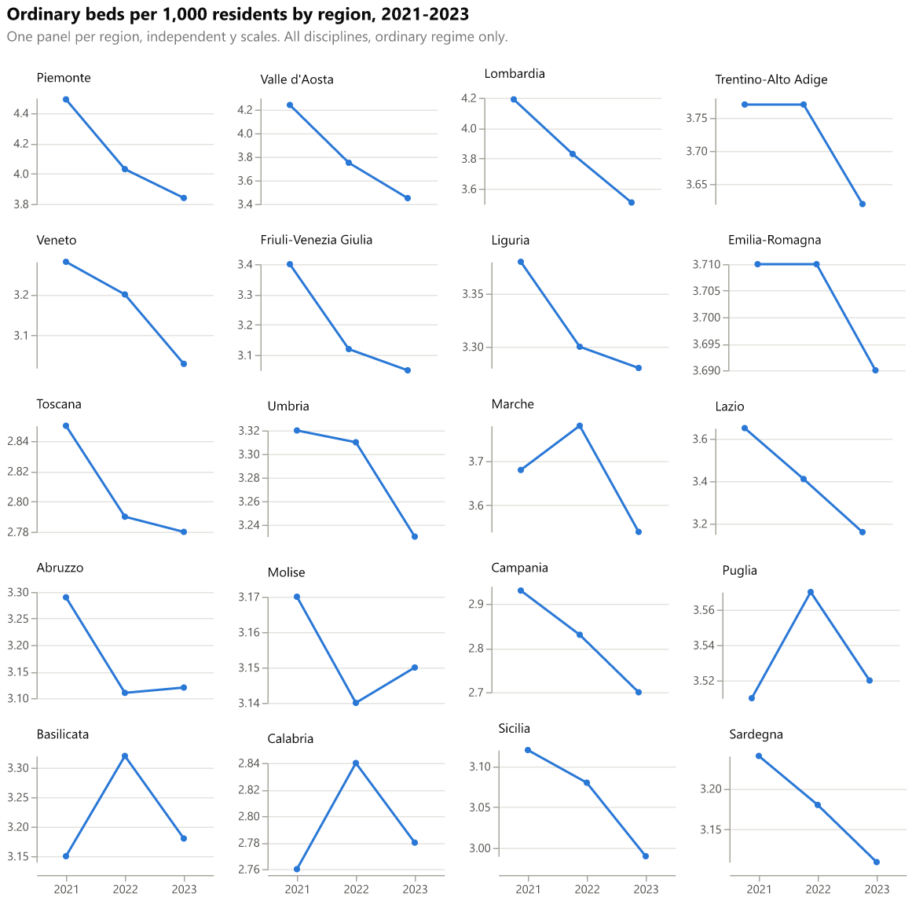
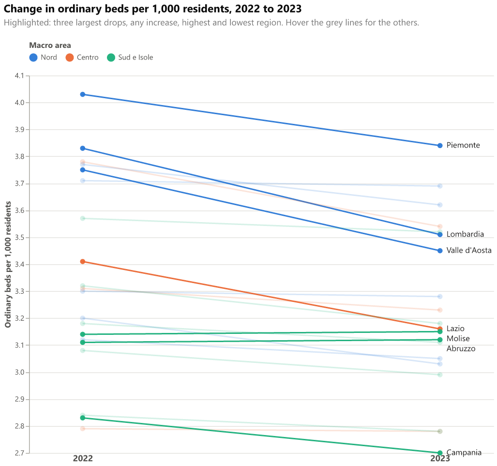
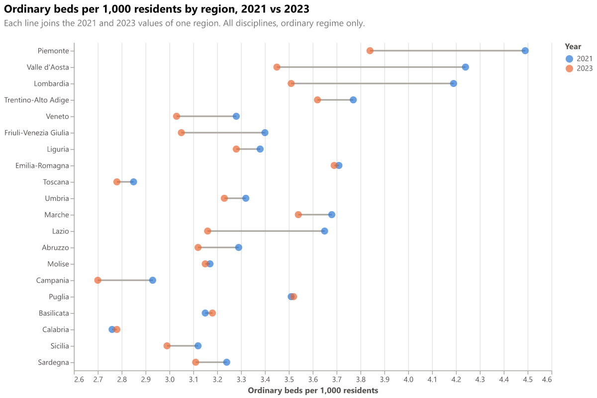
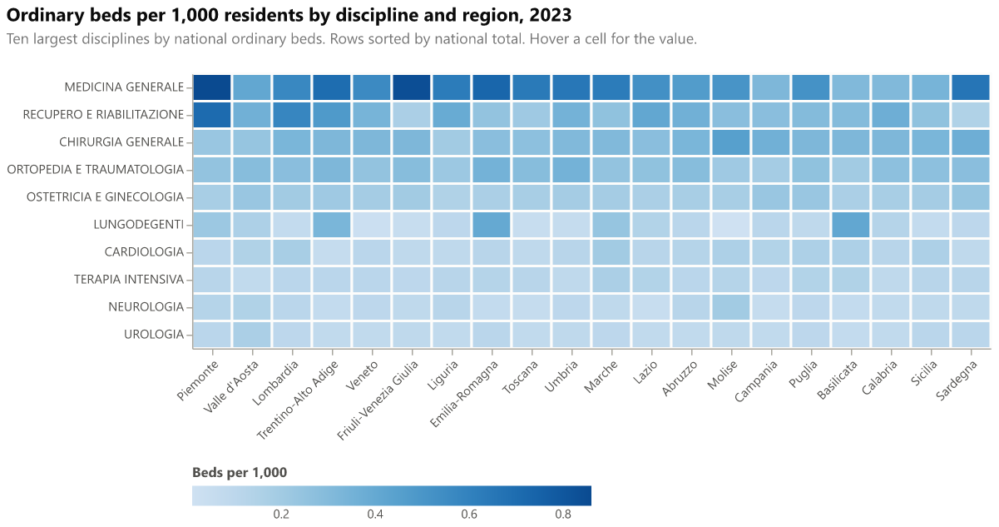

# deneb-gallery

Reusable [Deneb](https://deneb-viz.github.io/) (Power BI custom visual) templates written in Vega-Lite, and a static gallery that renders them live on a frozen gold dataset of Italian hospital beds and population, 2021 to 2023.

**Gallery:** https://dianim-code.github.io/deneb-gallery/

Each template comes in three forms: a Deneb template to import (`template.json`), a standalone Vega-Lite spec (`spec.vl.json`), and a README with the field list.

## Templates

| Template | What it shows | Preview |
|---|---|---|
| [Bullet chart: beds per 1,000 residents](templates/bullet-beds-per-1000/README.md) | Each region's ordinary beds per 1,000 residents against the national value |  |
| [Ranked bar with national average](templates/ranked-bar-national-average/README.md) | Regions ranked, with a dashed line at the national average |  |
| [Small multiples by region](templates/small-multiples-region-trend/README.md) | One trend panel per region, 2021 to 2023 |  |
| [Year-over-year slope chart](templates/slope-chart-yoy/README.md) | Change from 2022 to 2023 per region, coloured by macro area |  |
| [Dumbbell chart: 2021 vs 2023](templates/dumbbell-2021-2023/README.md) | Each region's 2021 and 2023 values joined by a line |  |
| [Heatmap: discipline by region](templates/heatmap-discipline-region/README.md) | Ten largest disciplines by region, 2023 |  |

## Use a template in Power BI

1. Open the template's `template.json` and copy its content (or use the **Copy template** button on the gallery).
2. In Power BI Desktop, add a **Deneb** visual and add at least one column or measure to it.
3. Open the **advanced editor**, choose **Create New Specification**, select **Existing template**, then import the file or paste the content (Ctrl+V).
4. Map each placeholder to a column or measure, then click **Create**.

The import flow follows the [Deneb templates documentation](https://deneb.guide/docs/templates). The field list and types are in each template's README. Templates use the `usermeta` format of Deneb 2.0 (metaVersion 2).

Not yet tested in Power BI Desktop (see Verification below).

## Data

The gold data (`sample-data/gold/`, with its contract in `contract/`) is a vendored copy. Do not edit it here; see `contract/VENDORED.md`.

The gallery needs flat tables, not joins. `scripts/build_gallery_data.py` aggregates the gold CSVs into three small JSON files in `site/data/`:

| File | Used by | Rows |
|---|---|---|
| `regions_2023.json` | bullet, ranked bar | 20 |
| `regions_by_year.json` | small multiples, slope, dumbbell (2021 to 2023) | 60 |
| `discipline_region_2023.json` | heatmap (ten largest disciplines) | 200 |

The files have one row per **ISTAT region** (20): the Ministry's two autonomous provinces, Bolzano and
Trento, are summed into Trentino-Alto Adige through `dim_region.istat_region_name` (contract 1.1.0), beds
and population first, then the ratio (ADR-015).

**Metric.** Beds per 1,000 residents = `beds_ordinary` summed over disciplines / population on 1 January × 1000, same region and year. The national value is the same calculation over all regions. Only the ordinary (overnight) regime is used, because it is the internationally comparable one. Day-hospital, day-surgery and paying beds are excluded.

The script also writes `templates/<name>/template.json` (the Deneb template, built from `spec.vl.json` by replacing each field name with its `__dataset.<i>__` placeholder) and the copies under `site/`.

## Validate and preview

All commands run from the project root with [uv](https://docs.astral.sh/uv/). There is no system Python dependency; uv creates `.venv/` from `pyproject.toml` and `uv.lock`.

```bash
# Rebuild the data and template files (after changing the gold data or a spec)
uv run scripts/build_gallery_data.py

# Check that the committed outputs are up to date (exit 1 if stale)
uv run scripts/build_gallery_data.py --check

# Validate every spec and template against the pinned schemas
# (downloads the Vega-Lite v6.4.3 and Deneb usermeta v2 schemas once into .cache/)
uv run scripts/validate_specs.py

# Regenerate preview.png for every template (vl-convert, Vega-Lite 6.4)
uv run scripts/render_previews.py

# Preview the gallery locally, with the same relative paths as GitHub Pages
uv run python -m http.server 8000 --directory site
# then open http://localhost:8000/
```

The server must serve the `site/` folder as the root, which is what `--directory site` does. The gallery loads its scripts from jsDelivr, so the internet must be reachable.

## Design choices

- **Palette.** Three categorical colours, one per macro area: blue `#2a78d6`, orange `#eb6834` and aqua `#1baf7a` in light mode, and `#3987e5`, `#d95926` and `#199e70` in dark mode. Each pair was checked to stay distinguishable under the common colour-vision deficiencies and readable on both surfaces. The Okabe-Ito set was tried first but its colours were too light or too dark for the dark background. Light-mode aqua has a contrast of only 2.74:1 against white, so the slope chart labels its highlighted lines directly instead of relying on colour, and every line has a tooltip.
- **Sequential scale.** The heatmap uses the ColorBrewer `blues` ramp, a single hue that is colour-vision-deficiency safe.
- **Dark mode.** The specs are authored in light colours. `site/app.js` swaps them for dark steps when the OS uses dark mode (palette, text, grid, muted bars), reverses the heatmap scale, sets a transparent background and re-renders on a change. The Deneb templates keep the light colours, because Deneb applies its own theme; the trade-off is described in ADR-013.
- **Version pinning.** Vega 6.4.0, Vega-Lite 6.4.3 and vega-embed 7.1.0 are the versions bundled by Deneb 2.0.1, the latest release (`apps/deneb/package.json` at tag `2.0.1.0`). The gallery loads them from jsDelivr at those exact versions, the specs point at the v6.4.3 schema, and the validator uses that schema. See ADR-011.
- **Responsive.** Charts use `width: container`. The small multiples have a fixed panel size (what Power BI needs), so the gallery picks as many columns as the card holds and narrows the panels to fit (three columns on a desktop card, two on a phone), and wraps long titles and subtitles, which Vega does not do on its own. The templates are not changed. No chart is wider than its card and the page has no horizontal scroll at 390 px and 1280 px.
- **No build step.** The site is static HTML, CSS and JS. `pages.yml` publishes `site/` as it is; the copies of the templates and data are generated and committed.

## Trade-offs

- **Light colours in Deneb.** The templates keep the light palette and text colours. In a dark Power BI theme the axis and label text may need a change in Deneb.
- **Labels.** The slope chart labels only the highlighted regions (largest drops, increases, highest, lowest). Labels are spaced in data units (Vega-Lite has no collision avoidance), so a nudged label can sit slightly below its point.
- **Independent scales.** The small multiples use independent y scales, so differences between regions in level are not shown, and small changes look large.
- **Fixed years.** The slope and dumbbell specs filter years inside the spec. Changing the years means editing the filter.
- **Generated copies.** `site/templates/` and `site/data/` are generated copies. Run the build script after any change.

## Verification status

- All six specs and their Deneb templates validate against the Vega-Lite v6.4.3 schema, and each template's usermeta validates against the Deneb usermeta v2 schema (`scripts/validate_specs.py`).
- The previews are rendered by vl-convert with Vega-Lite 6.4 (`scripts/render_previews.py`).
- The gallery was served locally and every referenced file was fetched without a 404. In headless Edge, all six charts rendered in light and dark mode, with no horizontal page scroll at 1280 px and 390 px.
- **Power BI Desktop:** the ranked bar was imported through Deneb's *Existing template* flow and read back from the saved report (ADR-014). The ranked bar, slope, dumbbell, small multiples and heatmap run in the `healthcare-semantic-model` report on the semantic model's measures. The bullet chart has not been run in Power BI.

## Data attribution

- **Hospital beds:** Ministero della Salute, published under the [Italian Open Data License v2.0](https://www.dati.gov.it/iodl/2.0/).
- **Population:** ISTAT, published under [CC BY 4.0](https://creativecommons.org/licenses/by/4.0/).

The data has been cleaned, re-keyed and aggregated for this project. Neither publisher endorses it. Sources are listed in `contract/VENDORED.md`.

## Repository layout

```
contract/            vendored data contract (read-only)
sample-data/gold/    vendored gold CSVs (read-only)
scripts/             build_gallery_data.py, validate_specs.py, render_previews.py
templates/<name>/    template.json, spec.vl.json, preview.png, README.md
site/                index.html, styles.css, app.js, data/, templates/ (generated copies)
docs/decisions.md    architecture decision log (ADR-001 onward)
```

Licence: MIT for code and templates (see `LICENSE`). The data in `sample-data/` and `site/data/` keeps the licences above.
