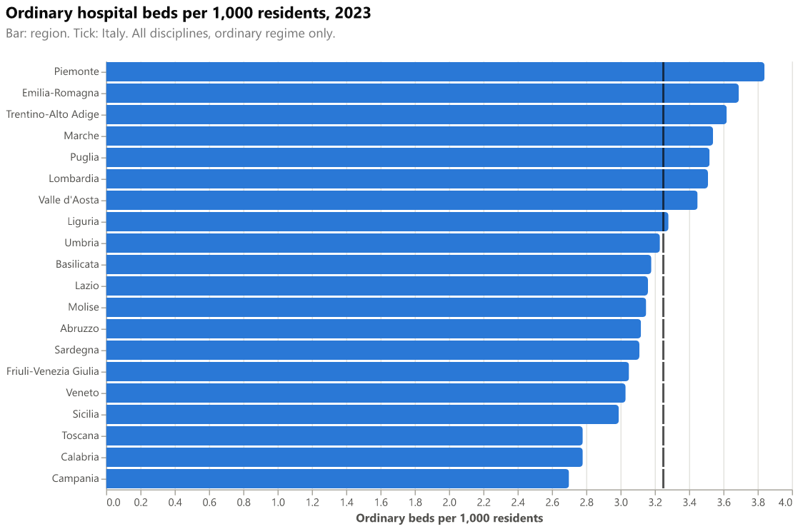

# Bullet chart: beds per 1,000 residents

Horizontal bars show ordinary beds per 1,000 residents for each region. A black tick marks the national value, so every region can be compared with Italy at a glance.

## Fields

| Placeholder | Name | Type | Meaning |
|---|---|---|---|
| `__dataset.0__` | `region_name` | text | Region or autonomous province (one row per region) |
| `__dataset.1__` | `beds_per_1000` | numeric | Ordinary beds per 1,000 residents, region, year |
| `__dataset.2__` | `national_per_1000` | numeric | Ordinary beds per 1,000 residents, Italy, same year (same value on every row) |

Use one year only. The gallery uses 2023. Each row needs the same `national_per_1000` value.

## Options

None. The chart has no parameters. Change colours or sizes in the Deneb visual's own settings, or edit the template before import.

## Metric

`beds_per_1000` = sum of `beds_ordinary` over all disciplines / resident population on 1 January × 1000. The national value is the same calculation over all regions. Only the ordinary (overnight) regime is included, because it is the internationally comparable one. Day-hospital, day-surgery and paying beds are excluded.

## Import into Deneb

1. In Power BI Desktop, add a **Deneb** visual and add at least one column or measure to it.
2. Open the **advanced editor** and choose **Create New Specification**.
3. Select **Existing template**, then click **Import your file** and choose `template.json`, or copy the file and paste it (Ctrl+V).
4. Map each placeholder to a column or measure of your model.
5. Click **Create**.

Steps follow the [Deneb templates documentation](https://deneb.guide/docs/templates).

## Files

- `template.json`: Deneb template (Vega-Lite 6.4.3 spec plus `usermeta`, metaVersion 2).
- `spec.vl.json`: standalone Vega-Lite spec for the gallery. Its data URL is `../../site/data/regions_2023.json`, relative to this folder.
- `preview.png`: rendered with vl-convert (Vega-Lite 6.4), see `scripts/render_previews.py`.

## Known limits

- This is a simplified bullet chart: it has a bar and a target tick, but no qualitative range bands.
- The chart is not sorted by the template itself; the sort uses `beds_per_1000` descending.
