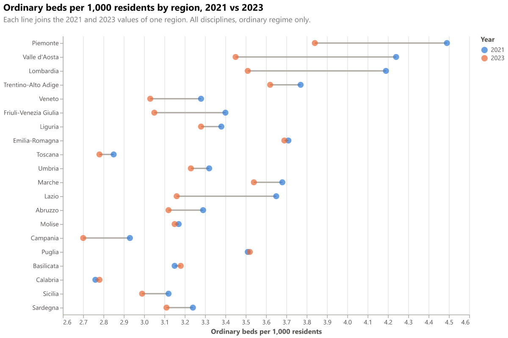

# Dumbbell chart: 2021 vs 2023

For each region, two dots show ordinary beds per 1,000 residents in 2021 and 2023, joined by a grey line. The line length is the change over the period.

## Fields

| Placeholder | Name | Type | Meaning |
|---|---|---|---|
| `__dataset.0__` | `region_name` | text | Region or autonomous province (one row per region and year) |
| `__dataset.1__` | `region_order` | numeric | Ministry display order of the region (sort key) |
| `__dataset.2__` | `year` | numeric | Reference year (1 January). Must be 2021 and 2023 in the data |
| `__dataset.3__` | `beds_per_1000` | numeric | Ordinary beds per 1,000 residents, region and year |

The spec keeps only 2021 and 2023 with the transform filter `datum.year == 2021 || datum.year == 2023`.

## Options

Colours: 2021 is blue and 2023 is orange (the first two validated categorical slots). Change the years in the transform filter and in the colour scale domain to compare other years.

## Metric

Same as the bullet chart: ordinary beds per 1,000 residents, all disciplines, ordinary regime only.

## Import into Deneb

1. Add a **Deneb** visual and add at least one column or measure to it.
2. Open the **advanced editor**, choose **Create New Specification**, select **Existing template**, then import or paste `template.json`.
3. Map the four placeholders, then click **Create**.

Steps follow the [Deneb templates documentation](https://deneb.guide/docs/templates).

## Files

- `template.json`: Deneb template (Vega-Lite 6.4.3, metaVersion 2).
- `spec.vl.json`: standalone spec. Data URL `../../site/data/regions_by_year.json`, relative to this folder.
- `preview.png`: rendered with vl-convert (Vega-Lite 6.4).

## Known limits

- The connecting line is drawn with `detail` on `region_name`, so each region must have exactly two points. A region with a missing year gets no connector.
