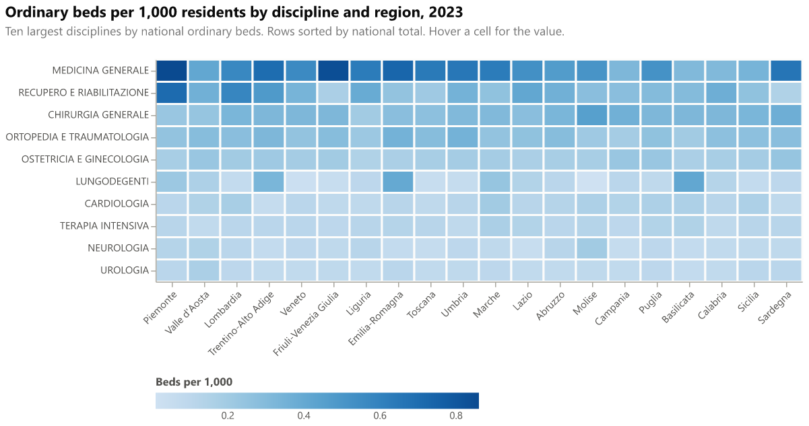

# Heatmap: discipline by region

Cells show ordinary beds per 1,000 residents for each discipline (rows) and region (columns), in one year. Rows are sorted by the national total. Colour uses a single-hue blue ramp, from light (low) to dark (high) on the light surface.

## Fields

| Placeholder | Name | Type | Meaning |
|---|---|---|---|
| `__dataset.0__` | `discipline_name` | text | Hospital discipline, Ministry name |
| `__dataset.1__` | `region_name` | text | Region or autonomous province |
| `__dataset.2__` | `region_order` | numeric | Ministry display order of the region (sort key for columns) |
| `__dataset.3__` | `beds_per_1000` | numeric | Ordinary beds per 1,000 residents, discipline and region, one year |

Each discipline and region pair needs one row. The gallery data has the ten largest disciplines by national ordinary beds (2023), so 210 rows. Several hundred rows also work.

## Options

Colour scale: `blues` (ColorBrewer, sequential, colour-vision-deficiency safe). In dark mode the gallery reverses this ramp. In Deneb, reverse it in the spec if your theme is dark.

## Metric

Same as the bullet chart: ordinary beds per 1,000 residents, ordinary regime only. Per-discipline values use the same region population as the regional totals.

## Import into Deneb

1. Add a **Deneb** visual and add at least one column or measure to it.
2. Open the **advanced editor**, choose **Create New Specification**, select **Existing template**, then import or paste `template.json`.
3. Map the four placeholders, then click **Create**.

Steps follow the [Deneb templates documentation](https://deneb.guide/docs/templates).

## Files

- `template.json`: Deneb template (Vega-Lite 6.4.3, metaVersion 2).
- `spec.vl.json`: standalone spec. Data URL `../../site/data/discipline_region_2023.json`, relative to this folder.
- `preview.png`: rendered with vl-convert (Vega-Lite 6.4).

## Known limits

- The gallery shows the top ten disciplines only. The full list (69 codes) would need a taller chart and more rows.
- Cells do not show numbers; the value is in the tooltip. The colour legend is at the bottom.
