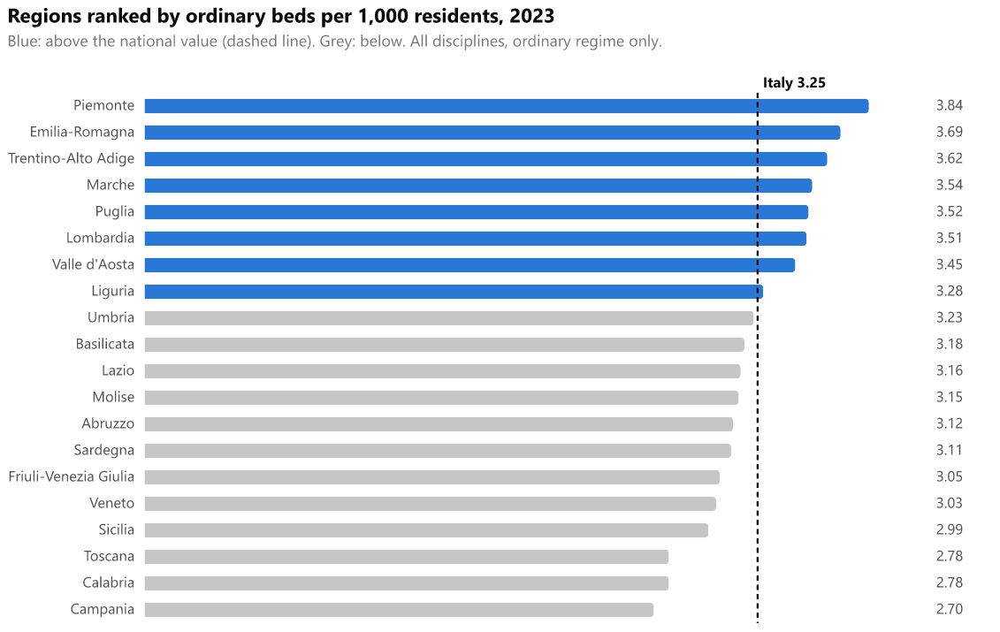

# Ranked bar with national average

Regions are sorted from highest to lowest by ordinary beds per 1,000 residents. A dashed vertical line marks the national average.

## Fields

| Placeholder | Name | Type | Meaning |
|---|---|---|---|
| `__dataset.0__` | `region_name` | text | Region or autonomous province (one row per region) |
| `__dataset.1__` | `beds_per_1000` | numeric | Ordinary beds per 1,000 residents, region, year |
| `__dataset.2__` | `national_per_1000` | numeric | Ordinary beds per 1,000 residents, Italy, same year (same value on every row) |

Use one year only. The gallery uses 2023.

With the `healthcare-semantic-model` report, map the fields to `'Region'[ISTAT Region]` (the 20 ISTAT regions; `'Region'[Region]` gives the 21 Ministry codes),
`[Ordinary Beds per 1,000 Residents]` and `[Ordinary Beds per 1,000 Residents (Italy)]`. The measures
evaluate at the latest year in the filter context, so no year filter gives 2023. This mapping was tested in
Power BI Desktop.

## Options

None.

## Metric

Same as the bullet chart: ordinary beds (all disciplines, ordinary regime only) divided by resident population on 1 January, times 1000. The national value is the total over all regions.

## Import into Deneb

1. Add a **Deneb** visual and add at least one column or measure to it.
2. Open the **advanced editor**, choose **Create New Specification**, select **Existing template**, then import or paste `template.json`.
3. Map the three placeholders, then click **Create**.

Steps follow the [Deneb templates documentation](https://deneb.guide/docs/templates).

## Files

- `template.json`: Deneb template (Vega-Lite 6.4.3, metaVersion 2).
- `spec.vl.json`: standalone spec. Data URL `../../site/data/regions_2023.json`, relative to this folder.
- `preview.png`: rendered with vl-convert (Vega-Lite 6.4).

## Known limits

- The reference line is a rule at the national value, not a band.
- The sort is applied by the template. Regions with equal values keep the order of the data.
