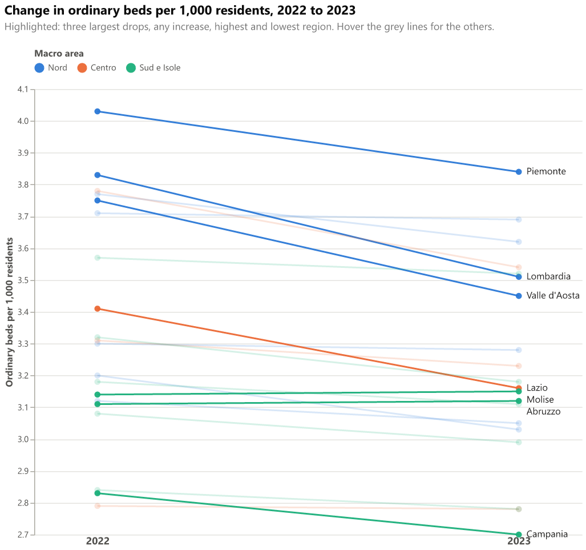

# Year-over-year slope chart

One line per region joins its value in the previous year to its value in the current year. Lines are coloured by macro area. Only the regions that tell the story are highlighted and labelled on the right: the three largest drops, any increase, the highest and the lowest region. The other lines stay faded, with a tooltip on hover.

## Fields

| Placeholder | Name | Type | Meaning |
|---|---|---|---|
| `__dataset.0__` | `region_name` | text | Region or autonomous province (one line per region) |
| `__dataset.1__` | `macro_area` | text | Three-way macro area: `Nord`, `Centro`, `Sud e Isole` |
| `__dataset.2__` | `year` | numeric | Reference year (1 January) |
| `__dataset.3__` | `beds_per_1000` | numeric | Ordinary beds per 1,000 residents, region and year |

## Options

The spec keeps only 2022 and 2023 with a transform filter: `datum.year >= 2022 && datum.year <= 2023`. The two years are also fixed in the `v2022` / `v2023` calculations (which compute each region's change) and in the label filter (`datum['year'] == 2023`). To compare other years, change all four places.

The highlight rule is one `calculate` (`highlight`): edit it to label more or fewer regions.

Labels never overlap. They are sorted by value and pushed down, when needed, so that each one sits at least one step below the previous one. The step is 2.8% of the value range (`label_gap`), enough for 11 px text when the plot area is about 500 px tall, as here. In a shorter visual, raise that factor: the `healthcare-semantic-model` report, whose plot area is about 330 px tall, uses 4%. Points and lines are not moved: a nudged label sits slightly below its point, in the same order.

## Metric

Same as the bullet chart: ordinary beds per 1,000 residents, all disciplines, ordinary regime only.

## Import into Deneb

1. Add a **Deneb** visual and add at least one column or measure to it.
2. Open the **advanced editor**, choose **Create New Specification**, select **Existing template**, then import or paste `template.json`.
3. Map the four placeholders, then click **Create**.

Steps follow the [Deneb templates documentation](https://deneb.guide/docs/templates).

## Files

- `template.json`: Deneb template (Vega-Lite 6.4.3, metaVersion 2).
- `spec.vl.json`: standalone spec. Data URL `../../site/data/regions_by_year.json`, relative to this folder.
- `preview.png`: rendered with vl-convert (Vega-Lite 6.4).

## Known limits

- The label spacing works in data units, not pixels: Vega-Lite has no label collision avoidance. With many highlighted regions in a narrow range, nudged labels can drift well below their points.
- The light-mode aqua colour (macro area "Sud e Isole") has a contrast of 2.74:1 on the light surface. Faded lines rely on the tooltip; highlighted lines carry a text label, which is the relief the palette requires.
