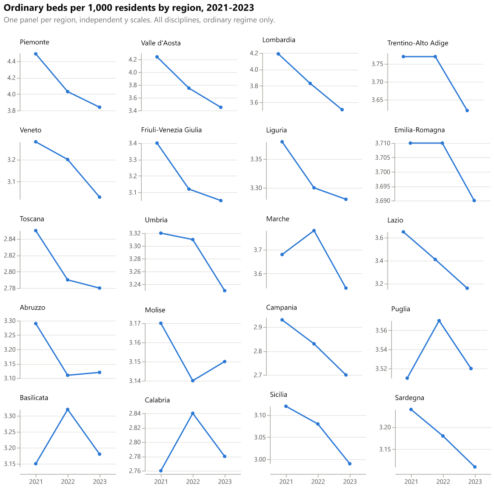

# Small multiples by region

One mini line chart per region, showing ordinary beds per 1,000 residents for each year. Each panel has its own y scale, so the shape of each trend is visible even where levels differ.

## Fields

| Placeholder | Name | Type | Meaning |
|---|---|---|---|
| `__dataset.0__` | `region_name` | text | Region or autonomous province (panel title) |
| `__dataset.1__` | `region_order` | numeric | Ministry display order of the region (sort key for panels) |
| `__dataset.2__` | `year` | numeric | Reference year (1 January), used on the x axis |
| `__dataset.3__` | `beds_per_1000` | numeric | Ordinary beds per 1,000 residents, region and year |

Use several consecutive years (the gallery uses 2021 to 2023). Each region needs one row per year.

## Options

- `columns` is 4 in the spec. The gallery shows 2 columns on narrow screens. In Deneb, change the columns by editing the spec in the advanced editor.

## Metric

Same as the bullet chart: ordinary beds per 1,000 residents, all disciplines, ordinary regime only.

## Import into Deneb

1. Add a **Deneb** visual and add at least one column or measure to it.
2. Open the **advanced editor**, choose **Create New Specification**, select **Existing template**, then import or paste `template.json`.
3. Map the four placeholders, then click **Create**.

Steps follow the [Deneb templates documentation](https://deneb.guide/docs/templates).

## Files

- `template.json`: Deneb template (Vega-Lite 6.4.3, metaVersion 2).
- `spec.vl.json`: standalone spec. Data URL `../../site/data/regions_by_year.json`, relative to this folder.
- `preview.png`: rendered with vl-convert (Vega-Lite 6.4).

## Known limits

- Independent y scales can exaggerate small changes (for example, Emilia-Romagna 2021 to 2023 looks steep). Compare the axis labels.
- Panels are shown in Ministry order. Facet sorting uses `region_order`.
